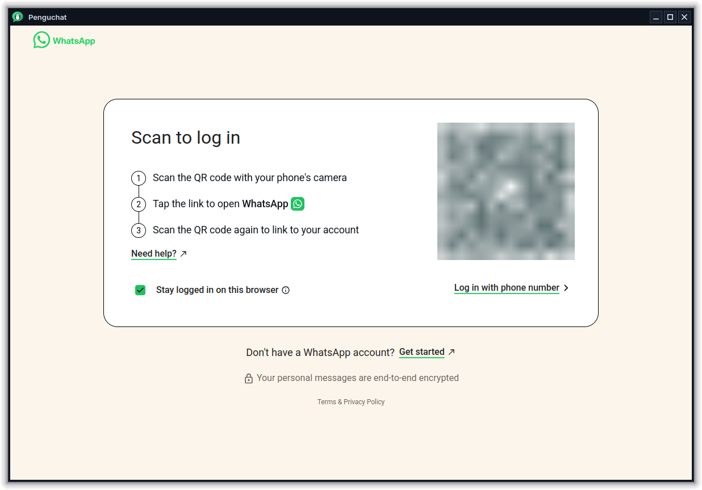

<p align="center"></p>

<h1 align="center">Penguchat</h1>

<p align="center">A small, native-feeling WhatsApp Web app for Linux.<br>
Works on any distro and any desktop: KDE Plasma, GNOME, Xfce, Cinnamon and more.</p>

---

Penguchat wraps [WhatsApp Web](https://web.whatsapp.com) in a lightweight PyQt6 + QtWebEngine window.
With your distro's Qt packages it uses your system Qt, so it follows your theme, window decorations
and notifications instead of shipping a whole Electron browser.

<p align="center"></p>

## Features

- **Stays logged in**: your session is kept in its own profile (`~/.local/share/penguchat`)
- **Native notifications** with the sender's picture; click one to jump to that chat
- **Tray icon** with an unread counter; left-click shows/hides the window
- **Unread badge** on the task bar / dock icon (KDE Plasma, Ubuntu Dock, Dash to Dock)
- **Close to tray** and **start at login**, both from the tray menu
- **Single instance**: launching it again just brings the window back
- Links open in your **default browser**; downloads go to `~/Downloads`
- Microphone and camera work for voice messages and calls
- Remembers window size and zoom level

## Install

### Flatpak (any distro)

Download `penguchat.flatpak` from the [latest release](https://github.com/hTulu07/penguchat/releases/latest), then:

```bash
flatpak install --user penguchat.flatpak
flatpak run io.github.htulu07.Penguchat
```

It pulls the KDE runtime from Flathub the first time, so Flathub must be set up
([setup guide](https://flathub.org/setup)).

### Arch Linux (AUR)

```bash
yay -S penguchat
```

Or build it yourself from this repo: `cd packaging/aur && makepkg -si`

### From source

```bash
git clone https://github.com/hTulu07/penguchat.git
cd penguchat
./install.sh
```

Everything goes into `~/.local` for your user only. If PyQt6 is missing, the script tells you
the command for your distro:

| Distro | Command |
| --- | --- |
| Fedora | `sudo dnf install python3-pyqt6 python3-pyqt6-webengine` |
| Debian / Ubuntu / Mint | `sudo apt install python3-pyqt6 python3-pyqt6.qtwebengine` |
| Arch / Manjaro / EndeavourOS | `sudo pacman -S python-pyqt6 python-pyqt6-webengine` |
| openSUSE | `sudo zypper install python3-PyQt6 python3-PyQt6-WebEngine` |

**No packages for your distro, or no root?** Run `./install.sh --pip`. It downloads PyQt6 into a
private virtual environment (about 150 MB) and only needs `python3` with `venv`.

Then open **Penguchat** from your app menu and scan the QR code with your phone.

> **GNOME users:** GNOME has no tray by default. Install the
> [AppIndicator extension](https://extensions.gnome.org/extension/615/appindicator-support/)
> to get the tray icon. Without it Penguchat still works and simply quits when you close the window.

## Keyboard shortcuts

| Key | Action |
| --- | --- |
| `Ctrl+W` | Close the window (hides to tray) |
| `Ctrl+Q` | Quit |
| `Ctrl+R` / `F5` | Reload |
| `Ctrl++` / `Ctrl+-` / `Ctrl+0` | Zoom in / out / reset |
| `F11` | Fullscreen |

Run `penguchat --hidden` to start straight into the tray.

## Uninstall

```bash
./uninstall.sh          # removes the app, keeps your login
./uninstall.sh --purge  # also removes your login session and settings
```

## Disclaimer

Penguchat is an unofficial project and is not affiliated with, endorsed by or connected to
WhatsApp or Meta. It only shows the official WhatsApp Web site in a desktop window.

## License

[MIT](LICENSE)
